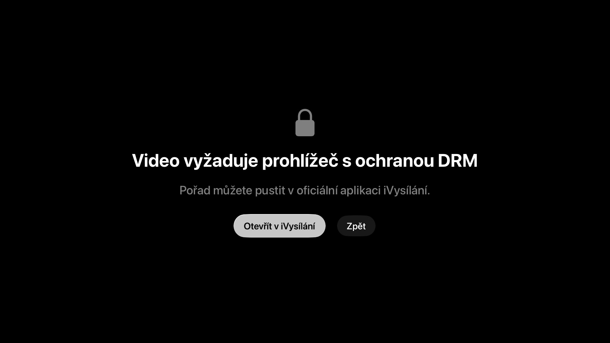

# Televize pro Apple TV

Nativní aplikace pro Apple TV (tvOS 17+), která přehrává **oficiální streamy České televize**:
živé vysílání šesti kanálů, TV průvodce na 7 dní zpět a 2 dny dopředu, „od začátku“ u právě
běžících pořadů a archiv iVysílání. Chování odpovídá specifikaci [`spec/apps.md`](../../spec/apps.md).

Aplikace si stream vyžádá vždy až na Apple TV těsně před přehráním (odkazy ČT jsou vázané na IP
a po hodině vyprší). Nic neukládá, nenahrává a neobchází DRM ani geoblokaci; když ČT pořad
na internetu nesmí pouštět, zobrazí se hláška ČT.

> Neoficiální projekt, není spojen s Českou televizí. ČT, ČT1 … a iVysílání jsou ochranné známky České televize.

Snímky obrazovky jen s testovacím obrazem (falešná brána Anténa) a chybovou obrazovkou:



## Požadavky

- Mac s Xcode 26 (stačí i Xcode 16 se Swift 6) a simulátorem tvOS (`xcodebuild -downloadPlatform tvOS`)
- [XcodeGen](https://github.com/yonaskolb/XcodeGen): `brew install xcodegen`
- Pro instalaci na skutečnou Apple TV: placený účet Apple Developer Program

## Struktura

- `CTCore/` – Swift balíček bez UI: klient API ČT, modely, pravidla výběru pořadu, dny průvodce,
  geometrie mřížky. Testy běží proti sdíleným fixturám v `spec/fixtures` (v kořeni repozitáře).
- `Televize/` – aplikace (SwiftUI + AVKit): `App/`, `UI/` (Živě, TV průvodce), `Player/`.
- `project.yml` – definice Xcode projektu. `Televize.xcodeproj` se z něj generuje a není v gitu.
- `tools/make_icons.swift` – vygeneruje zástupnou ikonu (bez loga ČT).

## Sestavení a spuštění

```sh
cd apps/tvos
xcodegen generate                       # po každé změně project.yml nebo přidání souboru
(cd CTCore && swift test)               # unit testy
xcodebuild -project Televize.xcodeproj -scheme Televize \
  -destination 'platform=tvOS Simulator,name=Apple TV' build
```

Nebo `open Televize.xcodeproj`, vybrat simulátor Apple TV a ⌘R. V simulátoru se ovládá šipkami,
Enter = výběr, Esc = tlačítko Menu/Zpět.

Ladicí parametry (jen v Debug buildu), např. `xcrun simctl launch booted cz.cztvhub.tv -tab guide`:

- `-tab guide` – otevře rovnou TV průvodce
- `-play live:CH_24`, `-play startover:CH_1`, `-play buffer:CH_1` (skončilo před < 3 h → Zpět v čase), `-play archive:CH_1`, `-play unavailable:CH_6`
- `-openOfficialApp YES` – zkusí otevřít stránku iVysílání v App Store; `-showDRMError YES` – ukáže obrazovku „vyžaduje DRM“
- `-breakURLs first` / `-breakURLs all` – nasimuluje vypršelý odkaz (test opakovaného načtení / chybové hlášky)

## Anténa (DVB-T2)

Pokud doma běží brána cz-tv-hub s tunerem (viz [`spec/dvb-gateway.md`](../../spec/dvb-gateway.md)), zadejte v záložce **Nastavení** její
adresu a klíč (uloží se do Klíčenky). V místní síti ji aplikace hledá přes Bonjour (`_cztvhub._tcp`),
přes Tailscale zadejte jméno Raspberry Pi v tailnetu. Pak přibude skupina „Anténa“ v Živě a řádky
v TV průvodci: živě, „Od začátku“ u právě nahrávaného pořadu a nahrané pořady (brána je maže po
nastavené době). Bez nastavení je skupina skrytá.

Vývoj proti falešné bráně na Macu: `-gatewayAddress 127.0.0.1:8098 -gatewayKey dev-key-dev-key-dev-key-dev-key-0000`,
pak např. `-play dvblive:1`, `-play dvbrec:1`, `-play dvbstartover:1` (číslo = číslo kanálu brány),
`-liveScroll antenna`, `-tab guide -guideRow 6`, `-tab settings`.

Volitelně **Přeskočit reklamu** (zapíná se na bráně, viz [`spec/ad-breaks.md`](../../spec/ad-breaks.md)): u hotových nahrávek
z antény nabídne systémové tlačítko vpravo dole během reklamního bloku.

## Team ID a TestFlight pro rodinu

1. V `project.yml` vyplňte `DEVELOPMENT_TEAM: "ABCDE12345"` (Team ID najdete na
   developer.apple.com → Account → Membership) a spusťte `xcodegen generate`.
   Případně stačí v Xcode zvolit tým v *Signing & Capabilities* (podepisování je automatické).
2. V [App Store Connect](https://appstoreconnect.apple.com) vytvořte novou aplikaci: platforma tvOS,
   Bundle ID `cz.cztvhub.tv`. Název musí být v App Store unikátní – pokud je „Televize“ obsazený,
   zadejte např. „Televize Rodina“ (na Apple TV se stále zobrazí „Televize“).
3. V Xcode zvolte cíl *Any tvOS Device*, *Product → Archive*, pak *Distribute App → App Store Connect → Upload*.
   Před dalším nahráním zvyšte `CURRENT_PROJECT_VERSION` v `project.yml`.
4. V App Store Connect → *Users and Access* pozvěte členy rodiny (stačí role *Marketing*),
   pak v záložce *TestFlight* vytvořte skupinu *Internal Testing* a přidejte je. Interní testeři
   nepotřebují schválení od Applu (do 100 lidí).
5. Na Apple TV si nainstalují aplikaci **TestFlight**, přihlásí se svým Apple ID a nainstalují Televizi.
   Build v TestFlightu platí 90 dní, pak je potřeba nahrát nový.

Exportní prohlášení o šifrování je vyřešené v Info.plist (`ITSAppUsesNonExemptEncryption = NO`).

## Známá omezení

- Funguje jen z české IP adresy (stejně jako iVysílání). Pořady bez internetových práv ukazují
  obrazovku ČT „Pouze v TV vysílání“ nebo hlášku ČT – to je záměr, ne chyba.
- Opakované načtení po vypršení odkazu je otestované simulací (`-breakURLs`); obnovení přesné pozice
  uprostřed dlouhého přehrávání zatím nebylo ověřené na skutečné hodinové expiraci.
- Navigace v průvodci používá standardní focus engine tvOS: u velmi dlouhých pořadů může pohyb
  nahoru/dolů skočit na pořad v jiném čase. Ověřeno v simulátoru, na skutečné Apple TV s ovladačem
  Siri Remote ještě ne.
- Hledání brány přes Bonjour v simulátoru nic nenašlo (prohlížeč běží, služba z Macu se neobjevila);
  na skutečné Apple TV v domácí síti zatím neověřeno. Adresu lze vždy zadat ručně.
- Zatím bez vyhledávání a oblíbených. Ikona je jen zástupná.
